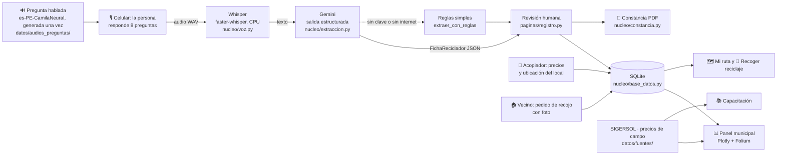

# ♻️ ReciclaVoz

> **Formalizamos a recicladores informales para las municipalidades del Perú mediante un registro por voz que llena la ficha con IA.**

Proyecto final de la Diplomatura en Ciencia de Datos para las Ciencias Sociales y la Gestión Pública (Q-Lab PUCP).

- **Demo:** https://proyectofinal-4h57dzu4nufopstr5nczcj.streamlit.app · o en local, ver [Cómo correrlo](#cómo-correrlo)
- **Video de respaldo:** `[COMPLETAR]`

---

## 1. One-liner

Hacemos **el registro y la formalización de recicladores** para **las municipalidades y las personas que reciclan**
mediante **una conversación por voz que Whisper transcribe y Gemini convierte en la ficha oficial**.

## 2. Founder

**Greicy Rodríguez**: antropóloga (PUCP). Mi tesis de licenciatura es una etnografía de los circuitos informales de
reciclaje en El Porvenir (Trujillo): conozco a quién le venden los recicladores, a qué precio y por qué desconfían
de los trámites. Ya construí el tablero [Lo que vale la basura](https://grey-d18.github.io/lo-que-vale-la-basura/),
que cruza SIGERSOL, la OEFA, el Banco Mundial y UN Comtrade con mi trabajo de campo. `[COMPLETAR: algo personal: por qué te importa]`

## 3. Problema

**Quién lo sufre**
- **Las personas que reciclan.** En el Perú hay unos **53 000 recicladores informales** frente a unos **13 800
  formales** (WIEGO 2021, recogido en *What a Waste 3.0* del Banco Mundial). Sin registro no entran a los programas
  de segregación en la fuente, no acceden a equipo ni capacitación y venden al precio del día: por el fierro, en El
  Porvenir se paga entre el 15 % y el 18 % del precio de exportación (trabajo de campo, 2026).
- **Las municipalidades.** La Ley 29419 y su reglamento (D. S. 005-2010-MINAM) les piden llevar un registro de
  recicladores y formalizarlos, pero lo hacen con fichas en papel, copias de DNI y firmas. El resultado es un
  registro incompleto: en 2024, el distrito de Trujillo reportó solo 1 375 t valorizadas de 126 500 t generadas
  (SIGERSOL), aunque en sus calles se recicla mucho más.

**Cuánto cuesta hoy** `[COMPLETAR con las entrevistas: horas por ficha, días de trabajo perdidos, personal de la oficina]`

**Cómo se resuelve hoy:** fichas en papel en la municipalidad, campañas puntuales de empadronamiento y Excel.

**Evidencia:** notas de 3 conversaciones con usuarios en [`docs/research/`](docs/research/).

## 4. Solución e insight

**Solución.** Una app web con botones grandes, pensada para personas que leen con dificultad. Al entrar se elige
**¿Quién eres?**:

1. **Soy reciclador**
   - **Registro por voz:** 8 preguntas, una por pantalla. Cada pregunta **se escucha** (voz natural con acento
     peruano, porque la persona puede no saber leer) y se responde hablando: se aprieta el micrófono para empezar y otra vez para
     terminar. Whisper transcribe, Gemini llena la ficha del registro con un esquema fijo, la persona revisa y se
     descarga una **constancia en PDF**.
   - **Capacitación:** buenas prácticas, cómo reconocer cada material, precios de referencia y un quiz.
   - **Mi ruta:** tabla de precios del día en su distrito (último precio, menor precio y en qué local) y un mapa con
     los locales de acopio y el reciclaje que hay para recoger.
   - **Recoger reciclaje** (con burbuja de aviso): los pedidos de los vecinos. Al marcar «Lo recogeré» se escucha que
     tiene 3 días; si no recoge, el pedido vuelve a estar disponible para otro reciclador de la zona.
2. **Soy vecino:** pide un recojo con descripción, peso y foto; elige un reciclador o «cualquiera de la zona».
3. **Soy acopiador:** ubica su local (con la ubicación del celular o escribiendo la dirección) y publica sus precios.
4. **Soy municipalidad** (en «más»): panel con inscritos por distrito, materiales, con qué se movilizan, quién no
   tiene guantes y la comparación con lo que el distrito reporta a SIGERSOL.

**Insight.** El cuello de botella de la formalización no es la ley sino **el formulario**. En el trabajo de campo, la
gente que recicla habla con fluidez de su trabajo (rutas, kilos, precios), pero muchas personas leen con dificultad y
desconfían de firmar papeles. Si el registro es una conversación, la barrera de entrada baja, y la conversación además
trae datos que el formulario nunca pidió.

## 5. Why now

- **Reconocimiento de voz abierto y barato:** Whisper (2022) y faster-whisper (2023) transcriben español en un CPU
  común, sin pagar por minuto y sin que el audio salga del servidor.
- **LLMs con salidas estructuradas y gratis:** hoy las APIs de modelos como Gemini obligan a que la respuesta cumpla un esquema JSON, y tienen un plan gratuito.
  Antes había que "rogarle" al modelo y limpiar el texto; hoy la ficha sale siempre en el formato del registro.
- **Micrófono en el navegador y celulares en todas partes:** no hay que instalar nada.
- **Presión por metas:** las municipalidades reportan valorización a SIGERSOL y tienen programas de segregación que
  exigen incluir recicladores formalizados.

## 6. Demo

**URL:** https://proyectofinal-4h57dzu4nufopstr5nczcj.streamlit.app

### Capturas

| ¿Quién eres? | Registro por voz | Mi ruta |
|---|---|---|
|  |  |  |

### Arquitectura



### Modelos y APIs

| Pieza | Qué usamos | Por qué |
|---|---|---|
| Voz → texto | **faster-whisper** (modelo `small`, int8, CPU) | Gratis, corre en el servidor (la voz y el DNI no salen a otra empresa) y entra en el plan gratuito de Streamlit |
| Texto → ficha | **Gemini 3.5 Flash-Lite** (`gemini-3.5-flash-lite`, plan gratuito, ~2 s por ficha) con salidas estructuradas (esquema Pydantic) | Gratis, entiende respuestas con rodeos («cartón y a veces latitas» → Cartón, Aluminio) y devuelve siempre el JSON de la ficha |
| Texto → voz | **`es-PE-CamilaNeural`** (voz neuronal de Microsoft con acento peruano) a través de la librería [`edge-tts`](https://github.com/rany2/edge-tts), velocidad −10 % | Natural, con la misma entonación en todas las preguntas y gratis sin cuenta. Los audios se generan una vez ([`scripts/generar_voces.py`](scripts/generar_voces.py)) y la app solo reproduce los MP3. Antes probé clonar mi voz: ver abajo |
| Plan B | Reglas con expresiones regulares | El demo funciona aunque no haya clave o se caiga internet |
| Mapas y gráficos | Folium + OpenStreetMap, Plotly | Herramientas del curso, sin costo |
| Grabación y ubicación | `st.audio_input` de Streamlit (graba a 16 kHz, lo que usa Whisper), `streamlit-js-eval` (ubicación del navegador), Nominatim de OpenStreetMap (dirección → mapa) | Gratis y sin instalar nada en el celular |
| Datos | 60 recicladores, 8 acopios, precios del día y 5 pedidos **sintéticos**; SIGERSOL (MINAM), precios del trabajo de campo, UN Comtrade | No se usan datos personales reales |

#### Texto a voz: lo que probamos primero

1. **Voz sintética del sistema** (macOS): se entendía, pero sonaba robótica y poco cercana.
2. **Mi voz clonada con Qwen3-TTS** (modelo abierto `Qwen/Qwen3-TTS-12Hz-0.6B-Base`, de Alibaba, 600 millones de
   parámetros, corriendo en mi laptop a partir de unos 20 s de mi voz grabada). Sonaba **más humana** que cualquier
   voz sintética, pero la **entonación de las preguntas no era natural ni constante**: cada audio salía con un ritmo y
   un tono distintos, a veces aceleraba al final y se comía la última palabra («¿A cuál?»), y había que escribir
   algunas palabras como se pronuncian («de ene i» para que no leyera «DNI» en inglés). Para controlarlo agregamos un
   chequeo con Whisper que volvía a generar cada audio hasta 4 veces, pero el resultado seguía siendo irregular. Además
   necesitaba un entorno aparte de unos 600 MB (PyTorch).
3. **`es-PE-CamilaNeural`** (la que usamos): voz neuronal de Microsoft Azure con **acento peruano**, gratuita mediante
   `edge-tts`. Suena natural, mantiene la misma entonación en todas las frases, lee bien «DNI» y genera los 10 audios
   en segundos. Lo comprobamos haciendo que Whisper escuche cada audio: todos se entienden completos. El servicio se usa
   sin un contrato con Microsoft, lo que está bien para un demo; en producción se usaría Azure Speech con una cuenta
   (tiene un plan gratuito) y la misma voz.

El script de clonación quedó en el historial de git (commit `f6f9b3a`) por si se quiere retomar.

### Limitaciones conocidas

- **Nombres propios.** Whisper no siempre escribe bien los nombres: «Anastasia Avelina» salió como «Anastasia
  velina», porque al hablar la *a* final de un nombre y la *A* inicial del otro se juntan en un solo sonido. No se
  arregla leyéndole el nombre de vuelta, porque suena igual. Le damos a Whisper una lista de apellidos frecuentes
  (`nucleo/voz.py`) y el registrador revisa la ficha, pero **la solución real es la RENIEC**: la municipalidad puede
  consultar el DNI en la RENIEC a través de la Plataforma de Interoperabilidad del Estado (PIDE). Con ese acceso
  bastaría con preguntar el DNI y el nombre oficial (y la edad) se llenaría solo, o se corregiría el nombre dictado.
  Como proyecto de curso no tenemos ese acceso.
- **La grabadora (lo que cambiamos).** Primero usamos `audio-recorder-streamlit`, que se detenía sola tras 3,5 s de
  silencio. Tenía dos problemas: es una pequeña página incrustada que se crea de nuevo en cada pregunta, así que
  **Safari (y el iPhone) pedía permiso del micrófono en cada pregunta**; y se ponía roja antes de que el micrófono
  estuviera abierto, así que si la persona hablaba de inmediato se perdía la primera sílaba («mi nombre es» →
  «hombre es»). La cambiamos por **`st.audio_input`** de Streamlit, que es parte de la página: el permiso se pide una
  sola vez. El costo es que ya no se detiene sola: se aprieta el micrófono otra vez para terminar.
- **Si igual se pierde el inicio.** Los ejemplos empiezan con una frase («Mi DNI es…») para que, si se corta el
  comienzo, se pierda esa frase y no un dato; Gemini ignora esas palabras de relleno, y si el DNI no queda con 8
  dígitos se marca para confirmar.

### Cómo correrlo

En la terminal de VS Code, desde la carpeta del proyecto:

```bash
uv venv --python 3.12 .venv
source .venv/bin/activate
uv pip install -r requirements.txt
cp .env.example .env        # y pon tu GEMINI_API_KEY gratis (opcional)
streamlit run app.py
```

Sin clave de Gemini la app funciona igual: llena la ficha con reglas simples.

**Desplegar en Streamlit Community Cloud:** *New app* → este repo → `app.py` → Python 3.12 → en *Advanced settings →
Secrets* pegar `GEMINI_API_KEY = "..."` (clave gratis de [Google AI Studio](https://aistudio.google.com/apikey), sin tarjeta).

### Estructura del código

```
app.py                     registra las páginas; sin menú lateral (se navega con botones)
paginas/
  inicio.py                «¿Quién eres?»: reciclador, vecino, acopiador (y municipalidad en «más»)
  reciclador.py            «¿Eres …?» y los 3 botones: Registro, Capacitación, Mi ruta
  registro.py              consentimiento → 8 preguntas habladas → ficha → constancia
  capacitacion.py          buenas prácticas, materiales, precios + mapa, quiz
  mi_ruta.py               tabla de precios del día y mapa de acopios y recojos
  recoger.py               pedidos de los vecinos, «Lo recogeré» y regla de los 3 días
  vecino.py                pedir un recojo (descripción, peso, foto, ubicación)
  acopiador.py             ubicar el local y publicar precios
  municipalidad.py         panel: indicadores, gráficos, mapa, SIGERSOL, lista
nucleo/
  config.py                rutas y claves (.env o st.secrets)
  catalogos.py             listas comunes: distritos, materiales, transporte y equipo
  preguntas.py             las 8 preguntas (texto, lo que dice el audio y un ejemplo) y los avisos
  voz.py                   Whisper
  extraccion.py            esquema de la ficha, Gemini y plan B con reglas
  base_datos.py            SQLite: recicladores, acopios, precios y recojos
  interfaz.py              botones grandes, voz, «Volver» y la burbuja de recojos
  ubicacion.py             centros de distrito, «usar mi ubicación» y «escribir mi dirección»
  constancia.py            PDF
  capacitacion.py          contenido de la capacitación
scripts/
  generar_sinteticos.py    crea los datos inventados (recicladores, acopios, precios, pedidos)
  generar_voces.py         crea los audios de las preguntas (voz es-PE-CamilaNeural, edge-tts)
datos/
  sinteticos/              recicladores, acopios, precios y pedidos inventados para el demo
  fuentes/                 datos reales: SIGERSOL y precios del trabajo de campo
  audios_preguntas/        las preguntas y avisos hablados (MP3)
docs/                      capturas y entrevistas
```

## 7. Modelo de negocio

**Quién paga:** la municipalidad (gerencia de residuos sólidos). Para la persona que recicla es **gratis**.

**Precio:** `[REVISAR con la entrevista a la municipalidad]` **S/ 350 al mes por distrito** (registro ilimitado, panel,
capacitación y exportación para SIGERSOL). Un distrito mediano gasta más que eso en una sola campaña de empadronamiento
en papel.

**Costo por usuario:**

| Concepto | Costo |
|---|---|
| Whisper | US$ 0 (corre en el servidor) |
| Gemini 3.5 Flash-Lite por registro (~500 tokens de entrada y ~300 de salida) | **US$ 0** en el plan gratuito (la app muestra los tokens de cada registro). En producción, con datos reales, se usaría el plan de pago, que no usa los datos para entrenar: menos de un centavo de dólar por registro |
| Servidor | Gratis en Streamlit Community Cloud para el piloto; ~US$ 10 al mes en un VPS para producción |

El piloto cuesta US$ 0. En producción, un distrito con 300 recicladores costaría menos de US$ 3 en tokens al año: el margen es casi todo el precio.

**Qué sigue:** piloto con una municipalidad de Trujillo, acopiadores reales publicando sus precios, WhatsApp como canal
y respuestas también habladas en Mi ruta (leer la tabla de precios en voz alta).

## 8. Herramientas del curso

| Herramienta | Sesión | Dónde está | Por qué esta |
|---|---|---|---|
| **De la voz al texto con Whisper** | 13 | [`nucleo/voz.py`](nucleo/voz.py) | Reemplaza el formulario: la persona habla en vez de escribir |
| **LLMs con salidas estructuradas** | 08 | [`nucleo/extraccion.py`](nucleo/extraccion.py) | Convierte respuestas con rodeos en la ficha exacta del registro |
| Texto a voz (primero clonación con Qwen3-TTS, al final es-PE-CamilaNeural) | 15 | [`scripts/generar_voces.py`](scripts/generar_voces.py), [`nucleo/interfaz.py`](nucleo/interfaz.py) | La persona escucha cada pregunta: no necesita saber leer |
| Dashboards | 05 | [`paginas/municipalidad.py`](paginas/municipalidad.py) | Lo que ve (y paga) la municipalidad |
| GeoPandas y Folium | 06 | [`paginas/mi_ruta.py`](paginas/mi_ruta.py), [`paginas/municipalidad.py`](paginas/municipalidad.py), [`paginas/capacitacion.py`](paginas/capacitacion.py) | Dónde vender, qué recoger y dónde viven los recicladores |

## 9. Qué hizo el agente

Usé **Claude Code** en VS Code. `[REVISAR y completar]`

- **Yo:** la idea, el diseño de la app por roles (reciclador, vecino, acopiador, municipalidad), la prueba de voces para las
  preguntas habladas (mi voz clonada con Qwen3-TTS y luego la voz con acento peruano), el problema y el usuario (de mi tesis), los precios de campo y los datos de SIGERSOL (de mi proyecto
  anterior), las preguntas del registro, las decisiones de producto y la revisión de cada archivo.
- **Claude Code generó:** la estructura del proyecto, el código de `nucleo/` y `paginas/` con comentarios explicativos,
  los scripts de datos sintéticos y de generación de voz, la prueba del flujo completo en el navegador y el borrador de
  este README.

---

*Datos: los recicladores del demo son sintéticos y los DNI son inventados. Los precios son referenciales. Licencia MIT.*
