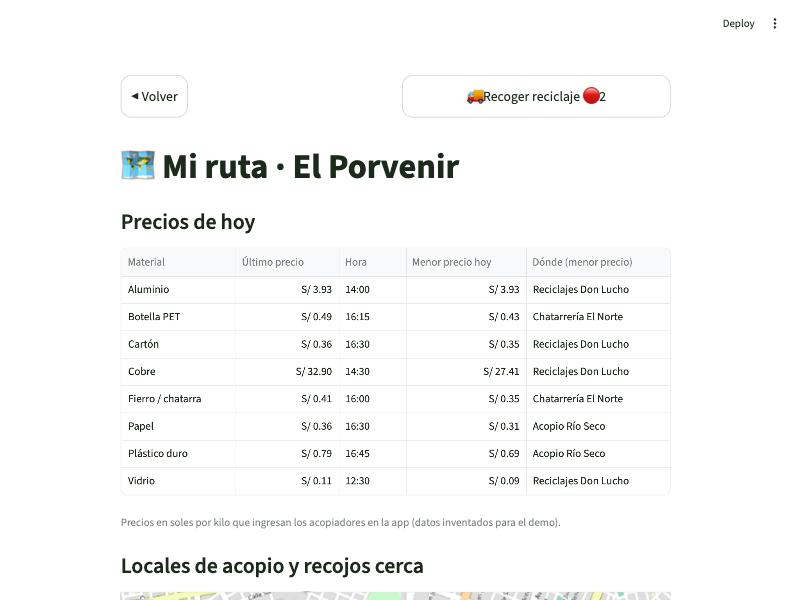
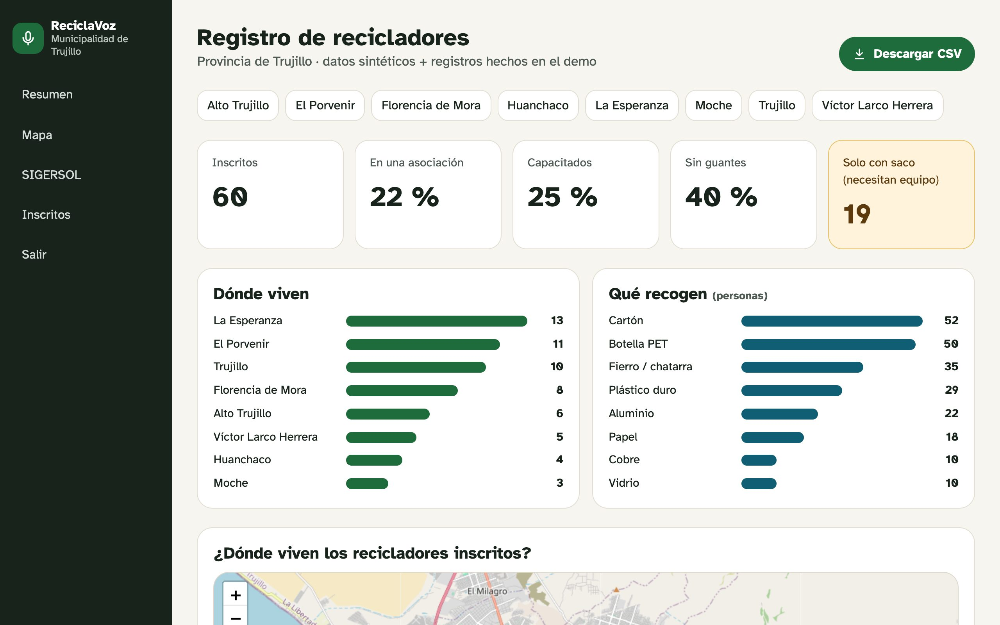
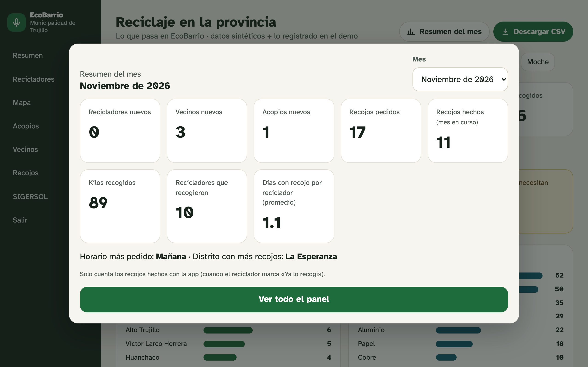
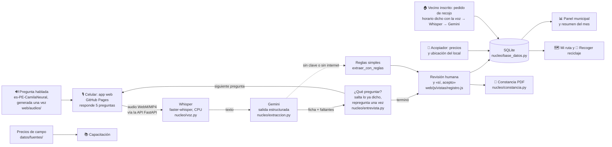

# ♻️ EcoBarrio

> **Formalizamos a recicladores informales para las municipalidades del Perú mediante un registro por voz que llena la ficha con IA.**

Proyecto final de la Diplomatura en Ciencia de Datos para las Ciencias Sociales y la Gestión Pública (Q-Lab PUCP).

- **Demo:** `[COMPLETAR: https://grey-d18.github.io/proyecto_final/ al publicar]` · o en local, ver [Cómo correrlo](#cómo-correrlo)
- **Video de respaldo:** `[COMPLETAR]`

---

## 1. One-liner

Hacemos **el registro y la formalización de recicladores** para **las municipalidades y las personas que reciclan**
mediante **una conversación por voz que Whisper transcribe y Gemini convierte en la ficha oficial**.

## 2. Founder

**Greicy Rodríguez**: antropóloga (PUCP). Mi tesis de licenciatura es una etnografía de los circuitos informales de
reciclaje en El Porvenir (Trujillo): conozco a quién le venden los recicladores, a qué precio y por qué desconfían
de los trámites. Ya construí el tablero [Lo que vale la basura](https://grey-d18.github.io/lo-que-vale-la-basura/),
que cruza SIGERSOL, la OEFA, el Banco Mundial y UN Comtrade con mi trabajo de campo. `[COMPLETAR: algo personal: por qué te importa]`

## 3. Problema

**Quién lo sufre**
- **Las personas que reciclan.** En el Perú hay unos **53 000 recicladores informales** frente a unos **13 800
  formales** (WIEGO 2021, recogido en *What a Waste 3.0* del Banco Mundial). Sin registro no entran a los programas
  de segregación en la fuente, no acceden a equipo ni capacitación y aceptan precios no regulados.
- **Las municipalidades.** La Ley 29419 y su reglamento (D. S. 005-2010-MINAM) les piden llevar un registro de
  recicladores y formalizarlos, pero lo hacen con fichas en papel, copias de DNI y firmas. Sin embargo, es difícil medir el logro del programa si no se sabe cuál es la población total de recicladores.


**¿Qué problemas enfrentan?** (de mi trabajo de campo, ver [`docs/research/`](docs/research/))
- **Papeles que no se entienden.** Algunos recicladores no saben leer y/o escribir, y formalizarse significa documentación y trámites con los que no están familiarizados.
- **Precio.** El acopiador puede cambiar el precio repentinamente y muchos venden por costumbre siempre al mismo comprador, sin saber que en otro lado les pagarían más.
- **Salud.** La mayoría no sabe cómo cuidarse: trabajan sin guantes ni mascarilla.
- **Material que se pierde.** Hay vecinos que separan su reciclaje, pero sin el contacto de un reciclador no tienen a
  quién avisar.

**Cómo se resuelve hoy:** fichas en papel en la municipalidad y campañas de empadronamiento pobres.

**Evidencia:** notas de 3 conversaciones con usuarios en [`docs/research/`](docs/research/).

## 4. Solución e insight

**Solución.** Una app web con botones grandes, pensada para personas que leen con dificultad. Al entrar se elige
**¿Quién eres?**:

1. **Soy reciclador**
   - **Registro por voz:** 5 preguntas abiertas, una por pantalla. Cada pregunta **se escucha** (voz natural con
     acento peruano, porque la persona puede no saber leer) y se responde hablando. Whisper transcribe y, después de
     cada respuesta, Gemini llena la ficha con un esquema fijo: si la persona ya dijo un dato, su pregunta se salta, y
     si falta uno, se repregunta una sola vez. Al final la app lee la ficha en voz alta (el DNI dígito por dígito), la
     persona dice **«sí, acepto»** como declaración jurada y se descarga una **constancia en PDF**.
   - **Capacitación:** buenas prácticas, cómo reconocer cada material, precios de referencia y un quiz.
   - **Mi ruta:** tabla de precios del día en su distrito (último precio, mayor precio y en qué local) y un mapa con
     los locales de acopio y el reciclaje que hay para recoger.
   - **Recoger reciclaje** (con burbuja de aviso): los pedidos de los vecinos. Al marcar «Lo recogeré» se escucha que
     tiene 3 días; si no recoge, el pedido vuelve a estar disponible para otro reciclador de la zona.
2. **Soy vecino:** se **inscribe una vez** (nombre, dirección, correo y celular, con su consentimiento) y pide recojos
   con descripción, peso y foto. Dice **cuándo pueden pasar** con su voz («lunes, miércoles y viernes de 7 a 9»):
   Whisper lo transcribe y Gemini lo convierte en días y horas, que puede corregir. Elige si **comparte su celular**
   con el reciclador que acepte el pedido (solo ese reciclador lo ve) y si lo recoge uno en particular o
   «cualquiera de la zona».
3. **Soy acopiador:** ubica su local (con la ubicación del celular o escribiendo la dirección) y publica sus precios.
4. **Soy municipalidad:** un panel con lo que pasa en la app: **recicladores** (por distrito, qué recogen, quién no
   tiene guantes o solo tiene un saco), **locales de acopio** (qué compran y cuándo actualizaron sus precios),
   **vecinos** inscritos y **recojos** (cuántos, a qué hora y qué días los piden). Al entrar ofrece un **resumen del
   mes** (inscritos nuevos, recojos hechos, kilos y cuántos días recogió en promedio cada reciclador, contando solo
   los recojos hechos con la app). Los datos personales se ven ocultos, y hay botones para ir a SIGERSOL.

**Solo lo que pide la ley.** El registro pide únicamente lo que exige el art. 34 b) del Reglamento de la Ley 29419
(D. S. 005-2010-MINAM, modificado por el D. S. 001-2022-MINAM); el resto (estado civil, estudios, ingresos, seguro)
es opcional y no se pregunta. Así la entrevista bajó de **8 a 5 preguntas** abiertas, y se salta la que ya se respondió.

**Insight.** El cuello de botella de la formalización no es la ley sino **el formulario**. En el trabajo de campo, la
gente que recicla habla con fluidez de su trabajo (rutas, kilos, precios), pero muchas personas leen con dificultad y
desconfían de firmar papeles. Si el registro es una conversación, la barrera de entrada baja: la persona responde con sus
palabras, sin leer ni firmar papeles, y la app guarda solo lo que pide la ley.

## 5. Why now

- **Reconocimiento de voz abierto y barato:** Whisper (2022) y faster-whisper (2023) transcriben español en un CPU
  común, sin pagar por minuto y sin que el audio salga del servidor.
- **La IA ya puede llenar un formulario sin errores de formato:** antes, cuando uno le pedía a la IA que ordenara
  datos, a veces respondía con texto de más o se olvidaba de un dato. Hoy se le da el molde de la ficha (nombre, DNI,
  fecha…) y la IA está obligada a llenarlo tal cual. Además, Gemini tiene un plan gratuito.
- **Micrófono en el navegador y celulares en todas partes:** no hay que instalar nada.
- **Presión por metas:** las municipalidades reportan valorización a SIGERSOL y tienen programas de segregación que
  exigen incluir recicladores formalizados.

## 6. Demo

**App web:** `[COMPLETAR: https://grey-d18.github.io/proyecto_final/ al publicar]` · la versión anterior en Streamlit
quedó guardada como respaldo en la rama [`version-streamlit`](../../tree/version-streamlit).

La app tiene dos partes:

- **`web/`, lo que ve la persona:** HTML, CSS y JavaScript, sin instalar nada. Se publica gratis en **GitHub Pages**
  y en el celular se puede «agregar a la pantalla de inicio» como una app.
- **`api/`, el motor:** una API en Python (**FastAPI**) que corre Whisper, Gemini, la base de datos y el PDF. Usa
  las funciones de `nucleo/`. En esta **versión de prueba** corre en la laptop de la autora (ver abajo).

Empezamos con Streamlit porque permitía tener un prototipo en horas. Pero se veía como una página de datos y no como
una app: se recargaba en cada toque, no permitía un menú fijo abajo ni un micrófono grande, y en el iPhone pedía
permiso del micrófono en cada pregunta. Por eso separamos la interfaz (web) del motor (API). La versión en
Streamlit no se borró de la historia: está completa en la rama `version-streamlit`.

### Capturas

| ¿Quién eres? | Registro por voz (se saltó la pregunta 2: ya lo había dicho) | Mi ruta |
|---|---|---|
|  |  |  |

**Panel de la municipalidad** (en computadora):



**Resumen del mes** (se ofrece al entrar al panel):



### Arquitectura



### Modelos y APIs

| Pieza | Qué usamos | Por qué |
|---|---|---|
| Voz → texto | **faster-whisper** (modelo `small`, int8, CPU) | Gratis y abierto, corre en nuestro servidor (la voz y el DNI no salen a otra empresa) y corre en una laptop común |
| Texto → ficha | **Gemini 3.5 Flash-Lite** (`gemini-3.5-flash-lite`, plan gratuito, ~2 s por ficha) con salidas estructuradas (esquema Pydantic) | Gratis, entiende respuestas con rodeos («cartón y a veces latitas» → Cartón, Aluminio) y devuelve siempre el JSON de la ficha |
| Texto → voz | **`es-PE-CamilaNeural`** (voz neuronal de Microsoft con acento peruano) a través de la librería [`edge-tts`](https://github.com/rany2/edge-tts), velocidad −10 % | Natural, con la misma entonación en todas las preguntas y gratis sin cuenta. Los audios se generan una vez ([`scripts/generar_voces.py`](scripts/generar_voces.py)) y la app solo reproduce los MP3. Antes probé clonar mi voz: ver abajo |
| Plan B | Reglas con expresiones regulares | El demo funciona aunque no haya clave o se caiga internet |
| Interfaz | HTML, CSS y JavaScript sin librerías ni compilación; letra Atkinson Hyperlegible (hecha para baja visión) | Se ve y se usa como una app, carga rápido en celulares sencillos y se publica gratis en GitHub Pages |
| API | **FastAPI** + uvicorn ([`api/main.py`](api/main.py)) | Abierta, simple y documenta sola sus rutas (`/docs`) |
| Mapas y gráficos | **Leaflet** + OpenStreetMap; barras hechas con HTML | Abiertos y sin costo |
| Grabación y ubicación | `MediaRecorder` del navegador ([`web/js/grabadora.js`](web/js/grabadora.js)), `navigator.geolocation` (GPS), Nominatim de OpenStreetMap (dirección → mapa) | Estándares del navegador: nada que instalar en el celular |
| Datos | 60 recicladores, 40 vecinos, 8 acopios, precios del día y 117 recojos (junio a noviembre) **sintéticos**; SIGERSOL (MINAM), precios del trabajo de campo, UN Comtrade | No se usan datos personales reales |

#### Texto a voz: lo que probamos primero

1. **Voz sintética del sistema** (macOS): se entendía, pero sonaba robótica y poco cercana.
2. **Mi voz clonada con Qwen3-TTS** (modelo abierto `Qwen/Qwen3-TTS-12Hz-0.6B-Base`, de Alibaba, 600 millones de
   parámetros, corriendo en mi laptop a partir de unos 20 s de mi voz grabada). Sonaba **más humana** que cualquier
   voz sintética, pero la **entonación de las preguntas no era natural ni constante**: cada audio salía con un ritmo y
   un tono distintos, a veces aceleraba al final y se comía la última palabra («¿A cuál?»), y había que escribir
   algunas palabras como se pronuncian («de ene i» para que no leyera «DNI» en inglés). Para controlarlo agregamos un
   chequeo con Whisper que volvía a generar cada audio hasta 4 veces, pero el resultado seguía siendo irregular. Además
   necesitaba un entorno aparte de unos 600 MB (PyTorch).
3. **`es-PE-CamilaNeural`** (la que usamos): voz neuronal de Microsoft Azure con **acento peruano**, gratuita mediante
   `edge-tts`. Suena natural, mantiene la misma entonación en todas las frases, lee bien «DNI» y genera los 10 audios
   en segundos. Lo comprobamos haciendo que Whisper escuche cada audio: todos se entienden completos. El servicio se usa
   sin un contrato con Microsoft, lo que está bien para un demo; en producción se usaría Azure Speech con una cuenta
   (tiene un plan gratuito) y la misma voz.

El script de clonación quedó en el historial de git (commit `f6f9b3a`) por si se quiere retomar.

### Limitaciones conocidas

- **Nombres propios.** Whisper no siempre escribe bien los nombres: «Anastasia Avelina» salió como «Anastasia
  velina», porque al hablar la *a* final de un nombre y la *A* inicial del otro se juntan en un solo sonido. No se
  arregla leyéndole el nombre de vuelta, porque suena igual. Le damos a Whisper una lista de apellidos frecuentes
  (`nucleo/voz.py`) y el registrador revisa la ficha, pero **la solución real es la RENIEC**: la municipalidad puede
  consultar el DNI en la RENIEC a través de la Plataforma de Interoperabilidad del Estado (PIDE). Con ese acceso
  bastaría con preguntar el DNI y el nombre oficial (y la edad) se llenaría solo, o se corregiría el nombre dictado.
  Como proyecto de curso no tenemos ese acceso.
- **La grabadora (lo que cambiamos).** En Streamlit probamos dos grabadoras: `audio-recorder-streamlit` pedía permiso
  del micrófono en cada pregunta en Safari y el iPhone, y se ponía roja antes de abrir el micrófono, así que se perdía
  la primera sílaba («mi nombre es» → «hombre es»); `st.audio_input` pedía permiso una vez pero no se detenía sola.
  En la app web la grabadora **abre el micrófono una sola vez** al apretar «Empezar» y lo deja abierto durante el
  registro: el permiso se pide una vez, la grabación empieza al instante y **se detiene sola** tras 3,5 s de silencio.
  Antes de cortar muestra una cuenta regresiva («¿Terminó? Termino en 3…») y, si la persona vuelve a hablar, sigue
  grabando. Al empezar mide el ruido del lugar para reconocer también la voz bajita. Y si igual se cortó, el botón
  **«Agregar más»** graba de nuevo y suma lo nuevo a lo que ya dijo. Cada respuesta puede durar hasta 30 segundos;
  las que suelen ser largas tienen más: nombre, fecha de nacimiento y género 40 s, y dirección y celular, trabajo y equipo
  50 s (`nucleo/preguntas.py`).
  Además le pedimos al navegador que **no** aplique cancelación de eco ni supresión de ruido: están hechas para
  llamadas y, en nuestras pruebas, deformaban la voz lo suficiente para que Whisper confundiera números.
- **Si igual se pierde el inicio.** Los ejemplos empiezan con una frase («Mi DNI es…») para que, si se corta el
  comienzo, se pierda esa frase y no un dato; Gemini ignora esas palabras de relleno, y si el DNI no queda con 8
  dígitos se marca para confirmar.
- **Es una versión de prueba: la API corre en una laptop.** La página está publicada en GitHub Pages, pero el motor
  (Whisper, Gemini, la base de datos) corre en la laptop de la autora y se conecta a internet con un **túnel
  temporal de Cloudflare**, gratis y sin cuenta ([`scripts/demo_en_vivo.sh`](scripts/demo_en_vivo.sh)). Así se puede
  probar en tiempo real desde cualquier celular, pero solo mientras la laptop está encendida; si no, la página
  avisa «El servidor está apagado». Buscamos un servidor gratuito y no hubo uno que alcance: Hugging Face ya solo
  da gratis páginas estáticas (correr Python pide el plan PRO, US$ 9 al mes) y los planes gratuitos de otros
  servicios dan 512 MB de memoria, menos de lo que necesita Whisper `small`. **Publicarlo de verdad implica pagar
  un servidor** (unos US$ 10 al mes, ver [Costos](#7-modelo-de-negocio)) y poner su dirección fija en
  [`web/js/config.js`](web/js/config.js).
- **La base de datos es local.** El archivo SQLite vive en la laptop: sirve para la prueba. En producción se usaría
  una base en la nube (por ejemplo, Postgres).

### Riesgos

- **Datos personales y datos sensibles (Ley 29733).** El registro guarda DNI, dirección, celular y fecha de
  nacimiento. Si se agregan el carné de vacunación o datos de salud (ver [Roadmap](#10-roadmap)), esos son **datos
  sensibles**: la ley pide para ellos un consentimiento expreso y por escrito, guardarlos con más protección y usarlos
  solo para el registro. Hoy el panel muestra el DNI, el correo y el celular ocultos, y el demo usa solo datos inventados.
- **Consentimiento explícito.** Antes de la primera pregunta la persona marca «Acepto» y, al final, dice «sí, acepto»
  como declaración jurada; se guarda lo que dijo y la hora. Sin eso, no se inscribe.
- **Los datos no se adivinan ni se envían a más servicios.** El género lo dice la persona en la pregunta 2: no se
  deduce del nombre. Antes del «sí, acepto», el resumen de la ficha se escucha así: la voz grabada (Camila) dice las
  frases fijas y los datos personales los lee la voz del propio celular, para no enviarlos a un servicio de voz en
  internet. El único servicio externo que recibe los datos es Gemini, con una espera máxima de 10 segundos.
- **Aviso de grabación de voz.** La bienvenida avisa, en pantalla y en voz alta, que la voz se graba solo para
  convertirla en texto. El audio se transcribe en el servidor y **no se guarda**: se borra apenas Whisper lo lee.

### Cómo correrlo

En la terminal de VS Code, desde la carpeta del proyecto (dos terminales):

```bash
uv venv --python 3.12 .venv
uv pip install --python .venv/bin/python -r api/requirements.txt
cp .env.example .env                                   # y pon tu GEMINI_API_KEY gratis (opcional)

.venv/bin/uvicorn api.main:app --reload --port 8000    # terminal 1: la API (http://localhost:8000/docs)
python3 -m http.server 5500 --directory web            # terminal 2: la app, en http://localhost:5500
```

Sin clave de Gemini la app funciona igual: llena la ficha con reglas simples. Las pruebas automáticas (DNI dicho en
palabras, respuesta con varios datos, faltante «por completar») se corren con
`uv run --with pytest --with-requirements api/requirements.txt pytest tests/`. Para ver la versión anterior en
Streamlit: `git switch version-streamlit`, luego `uv pip install -r requirements.txt` y `streamlit run app.py`.

**Prueba en vivo desde cualquier celular** (la API en tu laptop + un túnel de Cloudflare):

```bash
brew install cloudflared                 # una sola vez
bash scripts/demo_en_vivo.sh             # enciende la API y el túnel; muestra un enlace y un código QR
```

El enlace se ve así: `https://grey-d18.github.io/proyecto_final/?api=https://<algo>.trycloudflare.com`. La página
guarda esa dirección en el navegador. Por seguridad solo acepta direcciones `trycloudflare.com` o de la propia
laptop, para que nadie pueda mandar un enlace que desvíe los datos (DNI, voz) a otro servidor. Cada vez que se
enciende, el túnel tiene una dirección nueva: hay que compartir el enlace nuevo. Ctrl+C apaga todo.

**Publicar la app en GitHub Pages:** en GitHub, *Settings → Pages → Source: GitHub Actions*. Desde ahí, cada cambio
en `web/` que llega a `main` se publica solo ([`.github/workflows/pagina.yml`](.github/workflows/pagina.yml)).

### Estructura del código

```
web/                       la app que ve la persona (GitHub Pages)
  index.html               la única página: las pantallas se dibujan según lo que va después de «#»
  css/estilo.css           colores, letra, botones grandes y diseño para celular y computadora
  audios/                  las preguntas y avisos hablados (MP3, voz es-PE-CamilaNeural)
  js/
    app.js                 elige qué pantalla mostrar
    config.js              la dirección de la API
    api.js                 cómo pedirle datos a la API
    comun.js               íconos, voz, menú de abajo, mapas
    grabadora.js           micrófono: abre una vez, graba, se detiene solo con el silencio
    ubicacion.js           «usar mi ubicación» y «escribir dirección»
    vistas/                una pantalla por archivo: inicio, reciclador, registro, mi_ruta, recoger,
                           aprender, vecino, acopiador, municipalidad
api/
  main.py                  la API: cada ruta llama a una función de nucleo/
  requirements.txt         lo que necesita la API
nucleo/                    la lógica, sin interfaz (la usa la API)
  config.py                rutas y claves (.env o secretos)
  catalogos.py             listas comunes: distritos, materiales, transporte y equipo
  preguntas.py             las 5 preguntas, las repreguntas (texto, audio, ejemplo) y los avisos
  voz.py                   Whisper
  extraccion.py            esquema de la ficha (art. 34 b), Gemini, plan B con reglas y DNI dicho en palabras
  entrevista.py            qué preguntar después: salta lo ya dicho y repregunta cada faltante una vez
  base_datos.py            SQLite: recicladores, vecinos, acopios, precios y recojos
  ubicacion.py             centros de distrito y búsqueda de direcciones (OpenStreetMap)
  constancia.py            PDF
  capacitacion.py          contenido de la capacitación
scripts/
  generar_sinteticos.py    crea los datos inventados (recicladores, acopios, precios, pedidos)
  generar_voces.py         crea los audios de las preguntas (voz es-PE-CamilaNeural, edge-tts)
  demo_en_vivo.sh          prueba en vivo: enciende la API y el túnel de Cloudflare, muestra enlace y QR
datos/
  sinteticos/              recicladores, vecinos, acopios, precios y recojos inventados para el demo
  fuentes/                 datos reales: SIGERSOL y precios del trabajo de campo
tests/                     pruebas del registro (pytest)
docs/                      capturas y entrevistas
```

## 7. Modelo de negocio

**Quién paga:** la municipalidad (gerencia de residuos sólidos). Para la persona que recicla es **gratis**.

**Precio:** `[REVISAR con la entrevista a la municipalidad]` **S/ 350 al mes por distrito** (registro ilimitado, panel,
capacitación y exportación para SIGERSOL). Un distrito mediano gasta más que eso en una sola campaña de empadronamiento
en papel.

**Costo por usuario:**

| Concepto | Costo |
|---|---|
| Whisper | US$ 0 (corre en el servidor) |
| Gemini 3.5 Flash-Lite por registro (~500 tokens de entrada y ~300 de salida) | **US$ 0** en el plan gratuito (la app muestra los tokens de cada registro). En producción, con datos reales, se usaría el plan de pago, que no usa los datos para entrenar: menos de un centavo de dólar por registro |
| Servidor | Gratis en la prueba (GitHub Pages + la API en una laptop con túnel de Cloudflare); ~US$ 10 al mes en un VPS para producción |

El piloto cuesta US$ 0. En producción, un distrito con 300 recicladores costaría menos de US$ 3 en tokens al año: el margen es casi todo el precio.

**Qué sigue:** piloto con una municipalidad de Trujillo, **entrenar Whisper (fine-tuning) con audios reales de
vecinos y recicladores, con su permiso, para que reconozca bien las calles, barrios y asentamientos de Trujillo**
(hoy los confunde: le damos una lista de palabras y Gemini corrige los distritos, pero no basta), clases interactivas para que los acopiadores
sepan qué implica formalizarse como empresa operadora de residuos sólidos (un proyecto aparte), acopiadores reales publicando sus precios, WhatsApp como canal
y respuestas también habladas en Mi ruta (leer la tabla de precios en voz alta).

## 8. Herramientas del curso

| Herramienta | Sesión | Dónde está | Por qué esta |
|---|---|---|---|
| **De la voz al texto con Whisper** | 13 | [`nucleo/voz.py`](nucleo/voz.py) | Reemplaza el formulario: la persona habla en vez de escribir |
| **LLMs con salidas estructuradas** | 08 | [`nucleo/extraccion.py`](nucleo/extraccion.py) | Convierte respuestas con rodeos en la ficha exacta del registro, y el horario que dice el vecino («lunes y miércoles de 7 a 9») en días y horas |

**Extras** (no los contamos como herramientas del curso): las preguntas se escuchan en voz alta (texto a voz con
es-PE-CamilaNeural, [`scripts/generar_voces.py`](scripts/generar_voces.py); antes probamos clonar mi voz con
Qwen3-TTS), el panel de la municipalidad ([`web/js/vistas/municipalidad.js`](web/js/vistas/municipalidad.js)) y los
mapas con Leaflet y OpenStreetMap ([`web/js/vistas/mi_ruta.js`](web/js/vistas/mi_ruta.js)).

## 9. Qué hizo el agente

Usé **Claude Code** en VS Code. `[REVISAR y completar]`

- **Yo:** la idea, el diseño de la app por roles (reciclador, vecino, acopiador, municipalidad), la prueba de voces para las
  preguntas habladas (mi voz clonada con Qwen3-TTS y luego la voz con acento peruano), el problema y el usuario (de mi tesis), los precios de campo y los datos de SIGERSOL (de mi proyecto
  anterior), las preguntas del registro, las decisiones de producto y la revisión de cada archivo.
- **Claude Code generó:** la estructura del proyecto, el código de `nucleo/`, `api/` y `web/` con comentarios explicativos,
  los scripts de datos sintéticos y de generación de voz, la prueba del flujo completo en el navegador y el borrador de
  este README.

## 10. Roadmap

> ⚠️ **Nada de esta lista está implementado todavía.** Es lo que sigue después del curso.

- **Foto del DNI con OCR** (Document AI, sesión 10): llena nombre, DNI, fecha de nacimiento, sexo y dirección, y la
  entrevista baja de 5 a 3 preguntas. La foto también sirve como la copia simple del DNI que piden las municipalidades.
- **Foto del carné de vacunación** (tétanos y hepatitis B) **y de la constancia de capacitación**, para completar los
  requisitos del art. 34 c) y d).
- **Dirigente de la organización:** registra una vez los datos de la asociación (RUC con consulta a SUNAT, partida
  registral, junta directiva) e invita a sus socios con un enlace; la organización y el cargo se llenan solos.
- **Expediente completo para la mesa de partes** de la municipalidad: fichas, padrón de socios y la lista de
  requisitos de los art. 34 y 39.
- **Canal por WhatsApp con notas de voz**, para no tener que instalar nada.
- **Sin enviar datos a terceros:** reemplazar Gemini por un modelo abierto (**Qwen**, sesiones 08 y 09) que corra en el
  servidor de la municipalidad con Ollama. Lo probamos con Qwen 2.5 de 3B en la laptop: responde en unos 4 segundos y
  los datos no salen del servidor, pero todavía comete errores (dejó el DNI en palabras y metió un carácter chino en un
  apellido), así que necesita un modelo más grande o ajuste fino antes de usarse.

---

*Datos: los recicladores del demo son sintéticos y los DNI son inventados. Los precios son referenciales. Licencia MIT.*
