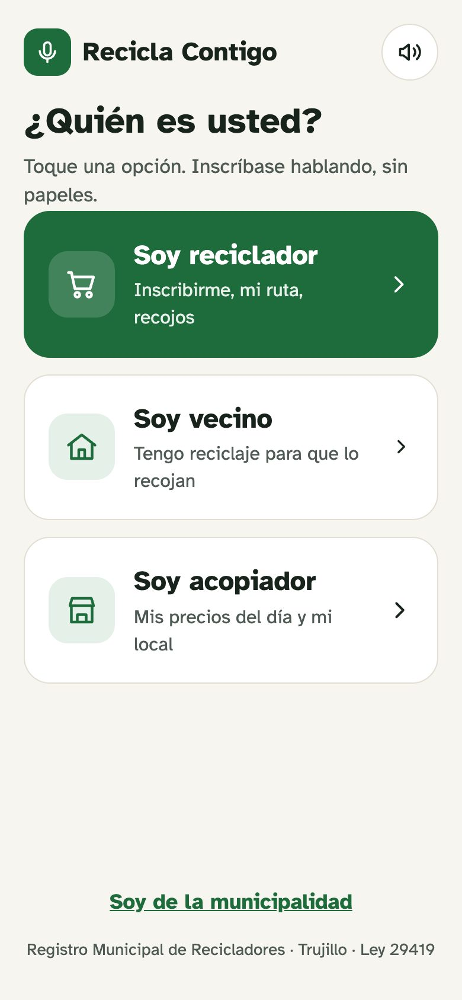
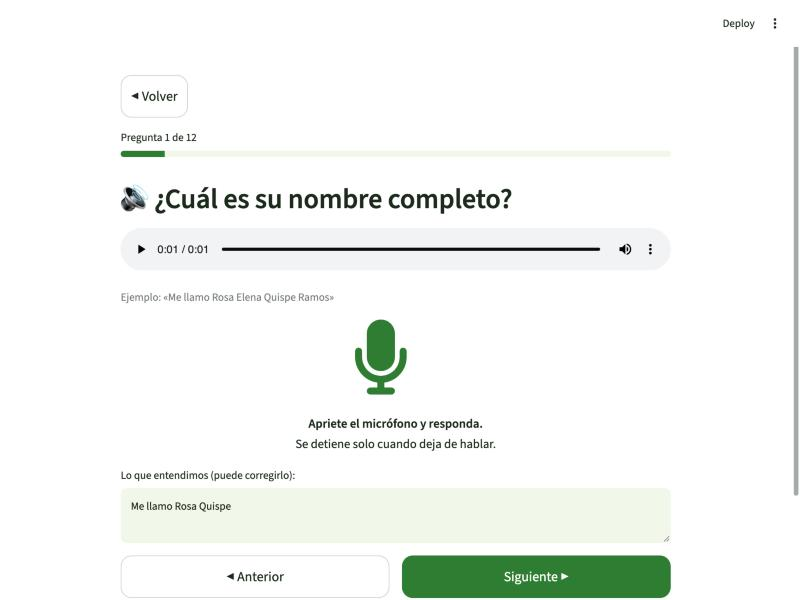
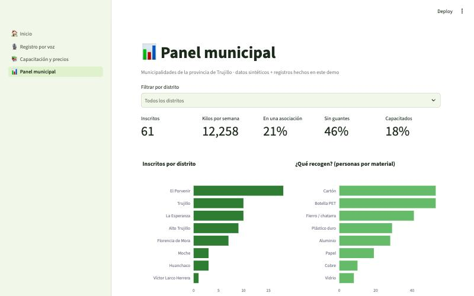
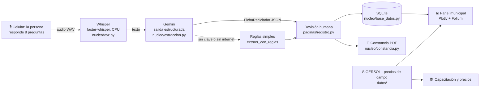

# ♻️ ReciclaVoz

> **Formalizamos a recicladores informales para las municipalidades del Perú mediante un registro por voz que llena la ficha con IA.**

Proyecto final de la Diplomatura en Ciencia de Datos para las Ciencias Sociales y la Gestión Pública (Q-Lab PUCP).

- **Demo:** https://proyectofinal-4h57dzu4nufopstr5nczcj.streamlit.app · o en local, ver [Cómo correrlo](#cómo-correrlo)
- **Video de respaldo:** `[COMPLETAR]`

---

## 1. One-liner

Hacemos **el registro y la formalización de recicladores** para **las municipalidades y las personas que reciclan**
mediante **una conversación por voz que Whisper transcribe y Gemini convierte en la ficha oficial**.

## 2. Founder

**Greicy Rodríguez**: antropóloga (PUCP). Mi tesis de licenciatura es una etnografía de los circuitos informales de
reciclaje en El Porvenir (Trujillo): conozco a quién le venden los recicladores, a qué precio y por qué desconfían
de los trámites. Ya construí el tablero [Lo que vale la basura](https://grey-d18.github.io/lo-que-vale-la-basura/),
que cruza SIGERSOL, la OEFA, el Banco Mundial y UN Comtrade con mi trabajo de campo. `[COMPLETAR: algo personal: por qué te importa]`

## 3. Problema

**Quién lo sufre**
- **Las personas que reciclan.** En el Perú hay unos **53 000 recicladores informales** frente a unos **13 800
  formales** (WIEGO 2021, recogido en *What a Waste 3.0* del Banco Mundial). Sin registro no entran a los programas
  de segregación en la fuente, no acceden a equipo ni capacitación y venden al precio del día: por el fierro, en El
  Porvenir se paga entre el 15 % y el 18 % del precio de exportación (trabajo de campo, 2026).
- **Las municipalidades.** La Ley 29419 y su reglamento (D. S. 005-2010-MINAM) les piden llevar un registro de
  recicladores y formalizarlos, pero lo hacen con fichas en papel, copias de DNI y firmas. El resultado es un
  registro incompleto: en 2024, el distrito de Trujillo reportó solo 1 375 t valorizadas de 126 500 t generadas
  (SIGERSOL), aunque en sus calles se recicla mucho más.

**Cuánto cuesta hoy** `[COMPLETAR con las entrevistas: horas por ficha, días de trabajo perdidos, personal de la oficina]`

**Cómo se resuelve hoy:** fichas en papel en la municipalidad, campañas puntuales de empadronamiento y Excel.

**Evidencia:** notas de 3 conversaciones con usuarios en [`docs/research/`](docs/research/).

## 4. Solución e insight

**Solución.** Una app web que funciona en el celular del promotor municipal o de la propia persona:

1. **Registro por voz:** 8 preguntas en lenguaje cotidiano; la persona responde hablando.
2. **Ficha automática:** Whisper transcribe; Gemini llena la ficha del registro con un esquema fijo y marca los datos
   que hay que confirmar. El promotor revisa y se genera una **constancia en PDF**.
3. **Capacitación y precios:** buenas prácticas, cómo reconocer cada material, precios de referencia y puntos de
   acopio en un mapa. Si aprueba el quiz, queda marcado como **capacitado**.
4. **Panel municipal:** inscritos por distrito, materiales, kilos recuperados, quién no tiene guantes, y la comparación
   con lo que el distrito reporta a SIGERSOL.

**Insight.** El cuello de botella de la formalización no es la ley sino **el formulario**. En el trabajo de campo, la
gente que recicla habla con fluidez de su trabajo (rutas, kilos, precios), pero muchas personas leen con dificultad y
desconfían de firmar papeles. Si el registro es una conversación, la barrera de entrada baja, y la conversación además
trae datos que el formulario nunca pidió.

## 5. Why now

- **Reconocimiento de voz abierto y barato:** Whisper (2022) y faster-whisper (2023) transcriben español en un CPU
  común, sin pagar por minuto y sin que el audio salga del servidor.
- **LLMs con salidas estructuradas y gratis:** hoy las APIs de modelos como Gemini obligan a que la respuesta cumpla un esquema JSON, y tienen un plan gratuito.
  Antes había que "rogarle" al modelo y limpiar el texto; hoy la ficha sale siempre en el formato del registro.
- **Micrófono en el navegador y celulares en todas partes:** no hay que instalar nada.
- **Presión por metas:** las municipalidades reportan valorización a SIGERSOL y tienen programas de segregación que
  exigen incluir recicladores formalizados.

## 6. Demo

**URL:** https://proyectofinal-4h57dzu4nufopstr5nczcj.streamlit.app

### Capturas

| Inicio | Registro por voz | Panel municipal |
|---|---|---|
|  |  |  |

### Arquitectura



### Modelos y APIs

| Pieza | Qué usamos | Por qué |
|---|---|---|
| Voz → texto | **faster-whisper** (modelo `base`, int8, CPU) | Gratis, corre en el servidor (la voz y el DNI no salen a otra empresa) y entra en el plan gratuito de Streamlit |
| Texto → ficha | **Gemini 3.5 Flash-Lite** (`gemini-3.5-flash-lite`, plan gratuito, ~2 s por ficha) con salidas estructuradas (esquema Pydantic) | Gratis, entiende respuestas con rodeos («de lunes a sábado» → 6 días) y devuelve siempre el JSON de la ficha |
| Plan B | Reglas con expresiones regulares | El demo funciona aunque no haya clave o se caiga internet |
| Mapas y gráficos | Folium + OpenStreetMap, Plotly | Herramientas del curso, sin costo |
| Datos | 60 recicladores **sintéticos**, SIGERSOL (MINAM), precios del trabajo de campo, UN Comtrade | No se usan datos personales reales |

### Cómo correrlo

En la terminal de VS Code, desde la carpeta del proyecto:

```bash
uv venv --python 3.12 .venv
source .venv/bin/activate
uv pip install -r requirements.txt
cp .env.example .env        # y pon tu GEMINI_API_KEY gratis (opcional)
streamlit run app.py
```

Sin clave de Gemini la app funciona igual: llena la ficha con reglas simples.

**Desplegar en Streamlit Community Cloud:** *New app* → este repo → `app.py` → Python 3.12 → en *Advanced settings →
Secrets* pegar `GEMINI_API_KEY = "..."` (clave gratis de [Google AI Studio](https://aistudio.google.com/apikey), sin tarjeta).

### Estructura del código

```
app.py                     menú de la app (st.navigation)
paginas/
  inicio.py                portada
  registro.py              flujo principal: consentimiento → 8 preguntas → ficha → constancia
  capacitacion.py          buenas prácticas, materiales, precios + mapa, quiz
  municipalidad.py         panel: indicadores, gráficos, mapa, SIGERSOL, lista
nucleo/
  config.py                rutas y claves (.env o st.secrets)
  preguntas.py             las 8 preguntas del registro
  voz.py                   Whisper
  extraccion.py            esquema de la ficha, Gemini y plan B con reglas
  base_datos.py            SQLite
  constancia.py            PDF
  capacitacion.py          contenido de la capacitación
scripts/
  generar_sinteticos.py    crea los 60 recicladores inventados
  generar_audios_ejemplo.py crea las voces de ejemplo (macOS)
datos/                     CSV de precios, SIGERSOL, puntos de acopio y audios de ejemplo
docs/                      capturas y entrevistas
```

## 7. Modelo de negocio

**Quién paga:** la municipalidad (gerencia de residuos sólidos). Para la persona que recicla es **gratis**.

**Precio:** `[REVISAR con la entrevista a la municipalidad]` **S/ 350 al mes por distrito** (registro ilimitado, panel,
capacitación y exportación para SIGERSOL). Un distrito mediano gasta más que eso en una sola campaña de empadronamiento
en papel.

**Costo por usuario:**

| Concepto | Costo |
|---|---|
| Whisper | US$ 0 (corre en el servidor) |
| Gemini 3.5 Flash-Lite por registro (~500 tokens de entrada y ~300 de salida) | **US$ 0** en el plan gratuito (la app muestra los tokens de cada registro). En producción, con datos reales, se usaría el plan de pago, que no usa los datos para entrenar: menos de un centavo de dólar por registro |
| Servidor | Gratis en Streamlit Community Cloud para el piloto; ~US$ 10 al mes en un VPS para producción |

El piloto cuesta US$ 0. En producción, un distrito con 300 recicladores costaría menos de US$ 3 en tokens al año: el margen es casi todo el precio.

**Qué sigue:** piloto con una municipalidad de Trujillo, lectura de las preguntas en voz alta (texto a voz, sesión 15),
WhatsApp como canal, y conexión con los puntos de acopio reales para publicar precios del día.

## 8. Herramientas del curso

| Herramienta | Sesión | Dónde está | Por qué esta |
|---|---|---|---|
| **De la voz al texto con Whisper** | 13 | [`nucleo/voz.py`](nucleo/voz.py) | Reemplaza el formulario: la persona habla en vez de escribir |
| **LLMs con salidas estructuradas** | 08 | [`nucleo/extraccion.py`](nucleo/extraccion.py) | Convierte respuestas con rodeos en la ficha exacta del registro |
| Dashboards | 05 | [`paginas/municipalidad.py`](paginas/municipalidad.py) | Lo que ve (y paga) la municipalidad |
| GeoPandas y Folium | 06 | [`paginas/municipalidad.py`](paginas/municipalidad.py), [`paginas/capacitacion.py`](paginas/capacitacion.py) | Dónde viven los recicladores y dónde vender |

## 9. Qué hizo el agente

Usé **Claude Code** en VS Code. `[REVISAR y completar]`

- **Yo:** la idea, el problema y el usuario (de mi tesis), los precios de campo y los datos de SIGERSOL (de mi proyecto
  anterior), las preguntas del registro, las decisiones de producto y la revisión de cada archivo.
- **Claude Code generó:** la estructura del proyecto, el código de `nucleo/` y `paginas/` con comentarios explicativos,
  los scripts de datos sintéticos y de audios de ejemplo, la prueba del flujo completo en el navegador y el borrador de
  este README.

---

*Datos: los recicladores del demo son sintéticos y los DNI son inventados. Los precios son referenciales. Licencia MIT.*
